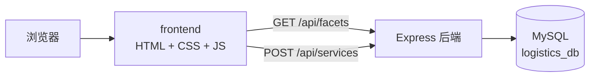

# 物流服务分面分类导航系统

《信息组织与检索》课程设计：为物流服务设计一套 **5 个分面的分类体系**，并用 Node.js + Express + MySQL 实现可组合筛选的导航网站。用户选择服务类型、运输方式、时效、目的地范围、特色服务等条件，系统实时返回匹配的物流服务。

<p>
  
  
  
  
</p>

---

## 分面体系

| 分面 | 取值 |
|---|---|
| **服务类型** | 快递、零担、整车 |
| **运输方式** | 陆运、空运、海运 |
| **时效** | 经济型、标准型、加急型 |
| **目的地范围** | 同城、国内、国际 |
| **特色服务** | 冷链、危险品、代收货款、无 |

共 5 个分面、16 个分面值、5 个示例服务。分面之间相互正交，可以任意组合筛选。

## 系统架构



## 功能

- **分面筛选**：按任意分面组合筛选服务，后端用多表连接和参数化查询实现；
- **动态加载**：页面启动时从 `/api/facets` 读取全部分面与取值，不在前端写死；
- **服务列表**：展示服务名称与描述，支持多条件同时过滤；
- **数据库初始化**：提供建表脚本和示例数据，包含分面、分面值、服务、服务-分面值关联四张表。

## 目录结构

```text
logistics-facet-navigation/
├── backend/
│   ├── database.js          # MySQL 连接池、分面查询、组合筛选
│   ├── server.js            # Express 路由
│   ├── package.json
│   └── .env.example         # 数据库连接配置模板
├── database/
│   ├── schema.sql           # 4 张表
│   └── data.sql             # 5 个分面 / 16 个分面值 / 5 个服务
├── docs/
│   ├── design_document.md   # 分面分类设计思路
│   └── classification_diagram.md
├── frontend/
│   ├── index.html
│   ├── script.js
│   └── style.css
└── README.md
```

## 快速开始

### 1. 初始化数据库

```bash
mysql -uroot -p -e "CREATE DATABASE logistics_db DEFAULT CHARACTER SET utf8mb4;"
mysql -uroot -p logistics_db < database/schema.sql
mysql -uroot -p logistics_db < database/data.sql
```

> `schema.sql` 会先删除同名表，重复执行会清空原有数据，请只在演示库中运行。

### 2. 启动后端

```bash
cd backend
npm install
cp .env.example .env        # Windows: copy .env.example .env
# 编辑 .env，填入 DB_PASSWORD
npm start
```

默认地址：`http://localhost:3000`。

### 3. 打开前端

用浏览器直接打开 `frontend/index.html`。前端会请求 `http://localhost:3000/api`，因此需要先启动后端。

## API

| 方法 | 路径 | 说明 |
|---|---|---|
| GET | `/api/facets` | 返回全部分面及其取值 |
| POST | `/api/services` | 按分面值组合筛选服务 |

请求示例（`filters` 的键是分面 `code`，值是 `facet_value.id` 数组）：

```json
{
  "filters": {
    "service_type": [1],
    "transport_mode": [4]
  }
}
```

## 数据库表

| 表 | 说明 |
|---|---|
| `facets` | 分面定义（服务类型、运输方式等） |
| `facet_values` | 每个分面的具体取值 |
| `services` | 物流服务产品 |
| `service_facet_values` | 服务与分面值的多对多关联 |

## 说明

- 示例服务名称仅用于课程分类演示，不代表任何企业的真实产品信息。
- 数据库密码只通过 `.env` 注入，`.env` 已被 `.gitignore` 排除；仓库中不包含真实密码。
- 本项目为课程设计，未接入用户系统，生产环境应补充鉴权、输入校验和 HTTPS。

## License

[Apache License 2.0](LICENSE)
